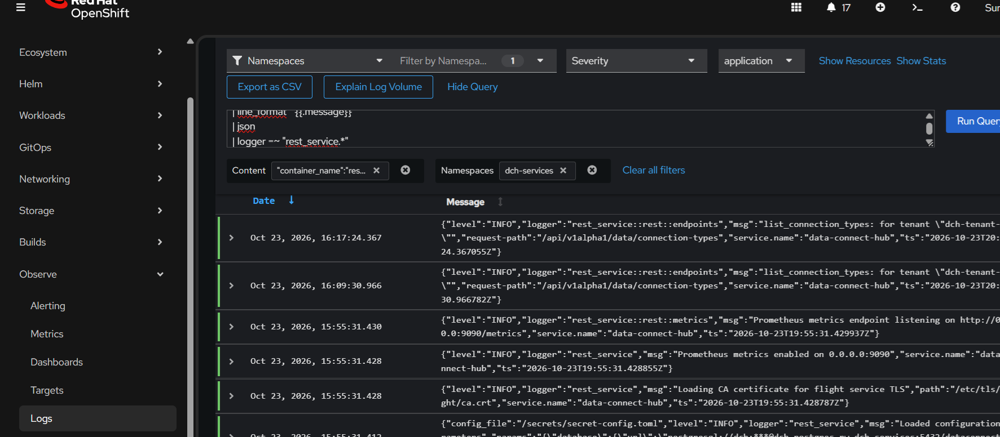
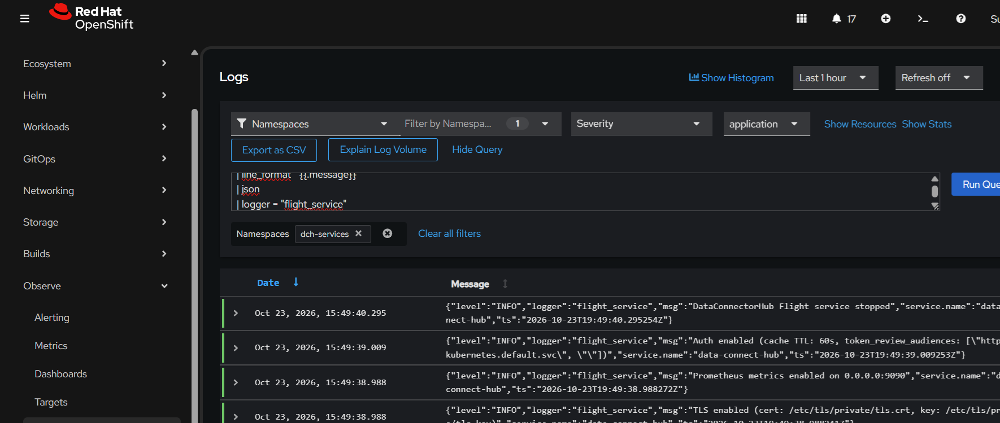
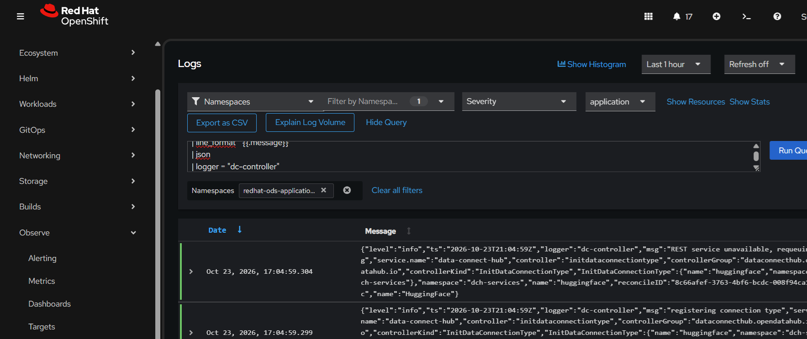

# DCH Logging

## Log Format

REST and Flight service logs now use JSON when the containers are started with
`--json-logs`. The controller uses controller-runtime's Zap JSON encoder. There's no additional configuration at system or user level needed to support this new log format.

Application logs include these fields:

```json
{
  "level": "INFO",
  "logger": "rest_service::rest::metrics",
  "msg": "Prometheus metrics endpoint listening on http://0.0.0.0:9090/metrics",
  "service.name": "data-connect-hub",
  "ts": "2026-10-23T19:55:31.429937Z"
}
```

Request-scoped REST and Flight logs can also include:

```json
{
  "trace_id": "4bf92f3577b34da6a3ce929d0e0e4736",
  "span_id": "00f067aa0ba902b7",
  "request-path": "/api/v1alpha1/data/connection-types"
}
```

The trace and request fields are emitted only when the corresponding context
is available. Controller logs currently do not have an HTTP request context or
OpenTelemetry span context, so those fields are normally absent.

## REST Queries

Show REST logs:

```logql
{kubernetes_namespace_name="dch-services"}
|= `"container_name":"rest-server"`
| json
| line_format `{{.message}}`
| json
| logger =~ "rest_service.*"
```
Here's an example of the log with a log forwarder such as Loki in an OpenShift cluster:


Filter REST logs by request path:

```logql
{kubernetes_namespace_name="dch-services"}
|= `"container_name":"rest-server"`
| json
| line_format `{{.message}}`
| json
| logger =~ "rest_service.*"
|= `"request-path":"/api/v1alpha1/data/connection-types"`
```

## Flight Queries

Show Flight service logs:

```logql
{kubernetes_namespace_name="dch-services"}
| json
| line_format `{{.message}}`
| json
| logger = "flight_service"
```
Here's an example of the log with a log forwarder such as Loki in an OpenShift cluster:


## Controller Queries

Show controller logs:

```logql
{kubernetes_namespace_name="redhat-ods-applications"}
| json
| line_format `{{.message}}`
| json
| logger = "dc-controller"
```
Here's an example of the log with a log forwarder such as Loki in an OpenShift cluster:


## Severity Filters

OpenShift adds an outer `level` field. Apply severity filtering before
unwrapping the inner application JSON:

```logql
{kubernetes_namespace_name="redhat-ods-applications"}
| json
| level =~ "info|inf|information|notice"
| line_format `{{.message}}`
| json
| logger = "dc-controller"
```

If the inner JSON is parsed after an outer `level` field already exists, Loki
may rename the inner field to `level_extracted`. In that case use:

```logql
{kubernetes_namespace_name="redhat-ods-applications"}
| json
| line_format `{{.message}}`
| json
| logger = "dc-controller"
| level_extracted =~ "info|inf|information|notice"
```